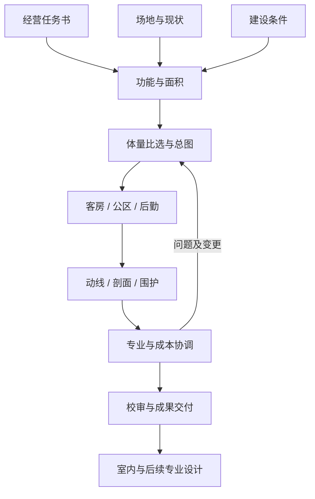

# 民宿建筑设计 · 15 Skills

把民宿经营任务、场地、建筑方案和专业交接拆为15项可调用技能。以客房、公区、后勤、地形和建筑接口为重点，共用对象编号、面积口径及版本记录。

2026-10-28已完成15项技能、14份阶段检查表、共享约定及本机安装。15项官方格式、51处内部引用、10项安装器测试通过，53个安装文件与主版本字节一致。详细结果见[验证记录](VALIDATION.md)。

## 技能目录

| Skill | 工作与主要成果 |
|---|---|
| [homestay-arch-orchestrator](skills/homestay-arch-orchestrator/SKILL.md) | 总控、阶段、版本及成果交接 |
| [homestay-arch-brief](skills/homestay-arch-brief/SKILL.md) | 经营活动、设计任务书及投资范围 |
| [homestay-arch-site](skills/homestay-arch-site/SKILL.md) | 场地证据、气候、现状与到达条件 |
| [homestay-arch-constraints](skills/homestay-arch-constraints/SKILL.md) | 建设条件、适用依据与待核事项 |
| [homestay-arch-program](skills/homestay-arch-program/SKILL.md) | 功能面积、空间邻接及楼层分配 |
| [homestay-arch-siteplan](skills/homestay-arch-siteplan/SKILL.md) | 建筑落位、入口、庭院及场地接口 |
| [homestay-arch-massing](skills/homestay-arch-massing/SKILL.md) | 体量方案、同条件比选与选定依据 |
| [homestay-arch-guestrooms](skills/homestay-arch-guestrooms/SKILL.md) | 房型模块、逐间清单与建筑条件 |
| [homestay-arch-public-spaces](skills/homestay-arch-public-spaces/SKILL.md) | 接待、餐饮、休闲与时段复用 |
| [homestay-arch-back-of-house](skills/homestay-arch-back-of-house/SKILL.md) | 布草、清洁、员工、配送及后勤空间 |
| [homestay-arch-circulation](skills/homestay-arch-circulation/SKILL.md) | 客人、服务、行李及跨层路径 |
| [homestay-arch-sections](skills/homestay-arch-sections/SKILL.md) | 剖面、标高、净高与地形适应 |
| [homestay-arch-envelope](skills/homestay-arch-envelope/SKILL.md) | 立面、屋面、开口与围护节点 |
| [homestay-arch-coordination](skills/homestay-arch-coordination/SKILL.md) | 专业冲突、可建造性、数量对账与成本影响 |
| [homestay-arch-delivery](skills/homestay-arch-delivery/SKILL.md) | 图纸及数据核对、校审交接与成果包 |

## 流程



阶段按实际输入迭代，局部任务可直接调用对应Skill。已有项目沿用其权威状态；本套作为民宿建筑阶段接入原全项目流程。

## 安装

Python 3.9及以上可运行安装器，无需网络、API Key或第三方运行库。共享约定及方法许可位于总控目录，因此整套安装。

```bash
git clone https://github.com/liuqing0224/homestay-architecture-skills.git
cd homestay-architecture-skills
python3 install.py --dry-run
python3 install.py --target ~/.codex/skills
python3 install.py --target ~/.codex/skills --check
```

安装前检查全部同名目录；存在冲突即停止。复制失败时清理本次创建的技能目录，保留原有技能。安装后核对实际文件字节。

## 调用

在安装后的新会话中使用：

```text
使用 $homestay-arch-orchestrator 完成这个民宿项目的建筑方案。
项目目录：<目录>
位置和场地类型：<实际情况>
建设性质：<新建/改造/扩建>
经营需求：<客群、可售客房目标、服务内容>
面积和投资：<数值、口径、包含范围>
已有资料：<测绘、图纸、照片、条件及当前方案>

先梳理资料和任务书，再完成空间面积与方案比较。
沿用项目现有编号、单位和选定版本，按阶段交付图纸、表单及检查记录。
```

也可直接要求“使用 `$homestay-arch-back-of-house` 检查当前方案的清洁、布草及配送空间”，或“使用 `$homestay-arch-coordination` 核对当前楼层图纸与客房清单”。

## GitHub方法如何融入

5个来源仓库的适用方法已写入阶段步骤及检查表：活动到空间、邻接矩阵、环境与到达来源、面积平衡、同范围数量对账、可建造性问题及IFC单位/对象追踪。仓库、固定提交、文件和采用位置见[SOURCES.md](SOURCES.md)，许可随套件保留于[第三方说明](THIRD_PARTY_NOTICES.md)。

本套包含指令、检查表、共享约定和状态模板。CAD/PDF生成、专业计算和IFC解析使用当前环境实际可用的工具；IFC方法是可选输入约定，未捆绑IfcOpenShell。具体项目采用的地区依据在运行时核验。

## 交接与验证

- [共享项目约定](skills/homestay-arch-orchestrator/references/project-contract.md)：来源、单位、坐标、面积、对象、版本与成果状态。
- [阶段与交接](skills/homestay-arch-orchestrator/references/routing-and-handoffs.md)：各阶段依赖、变更影响及旧民宿、室内、校审、管理套件的接入。
- [验证记录](VALIDATION.md)：技能格式、引用、来源与安装行为的实际检查结果。

安装器行为测试：

```bash
python3 -m unittest discover -s tests -v
```

开发格式检查另需`requirements-dev.txt`；安装器和技能文件本身不依赖这些开发库：

```bash
python3 -m pip install -r requirements-dev.txt
python3 tools/validate_package.py --out validation/package.json
```

检查器默认使用本机skill-creator的官方校验脚本，其他环境可通过`--official-validator <路径>`指定。
